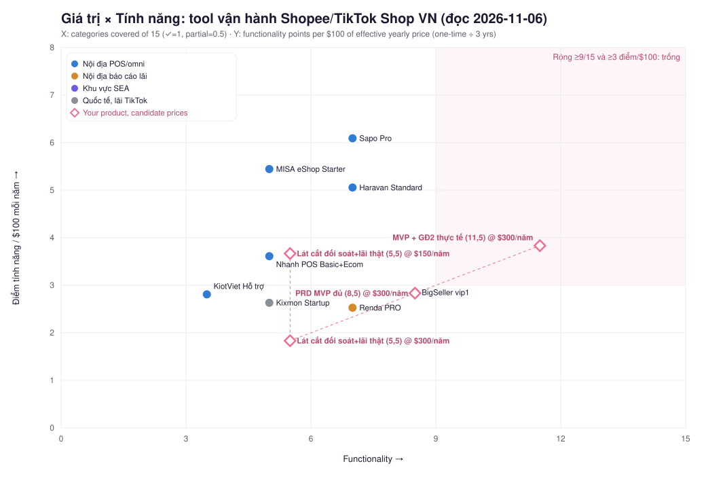

# Market research: tool vận hành đa sàn Shopee + TikTok Shop VN

Ngày đọc nguồn: 2026-11-06. Dựa trên PRD "Tool vận hành Shopee và TikTok Shop" v1.0 (05/11/2026, 16 trang).
Nhãn: `confirmed` = đã mở trang gốc; `secondary` = báo/tổng hợp; `vendor` = hãng tự nói; `giả định` = của mình.
Tỷ giá dùng để quy đổi: **1 USD = 26.000 VND** (giả định, sai số khoảng 1%).

## Mục tiêu (Bước 0)

Tôi cần biết đối thủ, giá, nỗi đau seller và kích thước thị trường về tool vận hành đa sàn Shopee/TikTok Shop VN, để quyết định **build hay không / giá bao nhiêu / vào bằng đường nào**.

## 1. Kết luận (đọc phần này nếu chỉ có 2 phút)

1. **Không nên build nguyên PRD như một sản phẩm "tất cả trong một".** Phần vận hành thuần (đồng bộ đơn, tồn, in tem) đã có 9+ hãng, nhiều hãng có vốn lớn (KiotViet được KKR rót $45M, BigSeller $210M năm 2022). Đua ở đó là đua với đối thủ có nhiều tiền hơn.
2. **Khoảng trống thật nằm ở một lát cắt hẹp: đối soát và lãi thật từng đơn cho cả Shopee lẫn TikTok, kèm quy trình duyệt và nhật ký thao tác.** Không hãng nào trong 15 hãng đã chấm gộp đủ cả ba:
   - Renda có lãi thật, tiền về ví, cảnh báo, nhưng không có tầng vận hành (không thấy tồn kho, in tem).
   - BigSeller có vận hành và lãi lỗ nhưng thiếu KOC theo lợi nhuận, ma trận duyệt và audit log.
   - Kixmon có lãi sau ads và theo creator, nhưng chỉ TikTok Shop và không thấy tiếng Việt.
3. **Kích thước thị trường cho một sản phẩm thuê bao thuần là nhỏ.** Chuỗi TAM/SAM/SOM bên dưới ra SAM nền ≈ $2,1M/năm và SOM 12 tháng nền ≈ $41 nghìn. Con số này phụ thuộc mạnh vào 3 giả định chưa có nguồn công khai (mục 7), nên đó là điều phải kiểm trước khi viết dòng code nào.
4. **Rủi ro API lớn hơn PRD thừa nhận.** TikTok Shop có Finance API chi tiết và GMV Max API hỗ trợ VN (qua cổng Business API riêng). Chat/CSKH bị chặn nếu chưa có ≥1.000 seller ủy quyền. Không thấy API đăng video. Shopee: không đọc được tài liệu gốc, và có một trường hợp công ty phần mềm VN bị từ chối ISV 3 lần (một người kể, không phải quy định).
5. **Đề xuất vào bằng đường nào:** MVP chỉ gồm module 04 (đối soát), lãi lỗ, theo dõi GMV Max, kèm phân quyền, duyệt, audit. Bán cho shop doanh số ≥100 triệu/tháng. Xác thực bằng bán trước và 5 cuộc phỏng vấn (mục 9).

## 2. Đối thủ và bảng giá thật

Giá VND, vùng VN, đọc 2026-11-06. Gói nhỏ nhất đủ nối Shopee + TikTok Shop.

| Hãng | Gói | Giá | Quy năm (USD) | Ghi chú | Nhãn |
|---|---|---|---|---|---|
| Sapo | Pro | 249.000đ/tháng | ≈ $115 | 5 gian hàng sàn, 10.000 đơn/tháng. Trang không ghi kỳ tính và VAT. Phí cài đặt 1–3 triệu, miễn nếu ký ≥2 năm | confirmed |
| Nhanh.vn | POS Basic + Nhanh.Ecom | 250.000 + 50.000đ/tháng | ≈ $138 | Giá list. Mua 2 năm: 150.000 + 50.000 | confirmed |
| KiotViet | Gói hỗ trợ | 270.000đ | ≈ $125 | Chỉ nối Shopee và TikTok Shop. Kỳ tính không ghi. Banner "8.000đ/ngày" không khớp (xem mục 8) | confirmed |
| Haravan | Standard | 300.000đ/tháng | ≈ $138 | Đã gồm VAT, trả theo năm, 3 gian hàng sàn | confirmed |
| MISA eShop | Starter | 199.000đ/tháng | ≈ $92 | Từ PDF báo giá 04/2025, trang web lệch ở gói cao hơn | confirmed (PDF) |
| Pancake POS | Free | 0đ | $0 | Miễn phí. Không có đối soát tiền về từ sàn | confirmed |
| Renda | PRO | 600.000đ | ≈ $277 nếu là /tháng | 3 shop. **Kỳ tính không ghi**, giả định tháng. Gói Free: 1 shop, làm mới 1 lần/ngày | confirmed (trang), kỳ = giả định |
| BigSeller | vip1 | 7.753.000đ/năm | ≈ $298 | 10.000 đơn, 12 shop, 5 user. Gói free: 1.500 đơn, 3 shop. Giá gạch 8,4 triệu, giảm thật 7,7% | confirmed (API giá site VN) |
| Ginee | Pro | Không công bố | n/a | Chỉ có hạn mức, giá phải liên hệ | confirmed |
| Kixmon | Startup | $190/năm | $190 | Chỉ TikTok Shop, 500 đơn/tháng. Không ghi mã tiền tệ | confirmed |

Công cụ dữ liệu thị trường TikTok (mảng khác, bổ trợ chứ không cạnh tranh trực tiếp): FastMoss Basic 342.000đ/tháng (≈ $13), Kalodata Starter $21,9/tháng, EchoTik $13,9/tháng. Đều không phải công cụ vận hành shop.

**Giá thật so với giá quảng cáo:**
- BigSeller: giá năm = 12 × tháng × 0,923 → giảm 7,7% (không phải mức "giảm sâu"). Giá 6 tháng = đúng 6 × giá tháng.
- Nhanh.vn: mua 2 năm giảm 26,7–40% tùy gói (tự tính từ giá list và giá 2 năm).
- Giá gia hạn: **không hãng nào công bố.** Chỉ Haravan ghi rõ VAT.
- Chưa đọc được giá: Salework, Abit, Pancake chat. Các trang render bằng JS hoặc không có bản VN.

### Bộ tiêu chí 15 hạng mục và điểm

Hạng mục (lấy từ PRD): 1 đồng bộ đơn · 2 tồn kho trung tâm · 3 SLA/cảnh báo quá hạn · 4 in tem/quét/đóng gói · 5 đối soát tiền thực nhận · 6 lãi lỗ theo đơn/SKU · 7 ads + lãi sau ads · 8 KOC theo lợi nhuận · 9 listing/giá hàng loạt · 10 khuyến mãi có mô phỏng lãi · 11 CSKH chat gộp · 12 lịch nội dung/đăng video · 13 livestream · 14 phân quyền + duyệt + audit · 15 AI đề xuất kèm bằng chứng.

Cách chấm: ✓ = 1, một phần = 0,5, "không thấy" = 0. **"Không thấy" nghĩa là không có trên các trang đã đọc, không chắc hãng không có tính năng.** Ô "chưa kiểm được" tính 0, nên điểm của Ginee là cận dưới.

| Hãng | Điểm /15 | Thấy mạnh | Thiếu |
|---|---|---|---|
| BigSeller | 8,5 | Đơn, tồn, in tem, lãi lỗ, listing | KOC, chat, livestream TikTok, ma trận duyệt, audit |
| Sapo | 7,0 | Đơn, tồn, in tem | SLA, KOC, khuyến mãi mô phỏng, lịch nội dung |
| Haravan | 7,0 | Đơn, tồn, listing, chat | SLA, KOC, khuyến mãi mô phỏng |
| Renda | 7,0 | SLA, đối soát, lãi thật, ROAS theo lợi nhuận | Tồn, in tem, listing, chat |
| Pancake POS | 5,5 | Đơn, tồn | SLA, KOC |
| Ginee | 5,5 (cận dưới) | Đơn, tồn, listing, chat | Ads, lãi, KOC |
| Nhanh.vn / MISA / Salework / Kixmon | 5,0 | | |
| Shop Manager | 4,0 | | |
| KiotViet | 3,5 | | |

**Ô trống toàn thị trường:** khuyến mãi có mô phỏng lợi nhuận (10) và lịch nội dung/đăng video (12): không hãng nào. KOC theo lợi nhuận (8): chỉ Kixmon (gói Max, TikTok) và Renda (một phần). SLA (3): chỉ Renda rõ ràng.

### Biểu đồ định vị



- Trục X: số hạng mục phủ (/15). Trục Y: điểm tính năng trên mỗi $100/năm. (Đã đổi từ $10 sang $100 so với script gốc, vì giá VN cao hơn nên điểm dồn sát đáy.)
- Giá quy năm: gói nhỏ nhất, giá list vì không hãng nào công bố giá gia hạn, tỷ giá 26.000đ/$.
- Ô thoi hồng là **giả thuyết** cho sản phẩm của mình (điểm tính năng 8,5 là MVP theo PRD, 11,5 là sau giai đoạn 2 trừ các module không có API, xem mục 5).
- Vùng "trống" (≥9 hạng mục, ≥3 điểm/$100): chưa hãng nào đứng. Điểm MVP + giai đoạn 2 ở $300/năm lọt vào đó, **nhưng đó là điều mình hứa chưa làm, không phải bằng chứng.**
- Bảng xếp hạng đầy đủ: `ranking.md`. Dữ liệu đầu vào: `data.json`.

## 3. Hồ sơ công ty (tiền chảy theo đường nào)

| Hãng | Thành lập | Chủ sở hữu | Vốn / thương vụ | Quy mô tự công bố | Nhãn |
|---|---|---|---|---|---|
| Sapo | 2008 (trang công ty) hoặc 2009 (registry) | Founder Trần Trọng Tuyến, VC thiểu số | Series A "7 chữ số USD" 05/2020 (Smilegate, Teko). Tin đàm phán $20M 05/2023, chưa thấy đã đóng | >230.000 khách; nhân sự 1.000+ (Tracxn: 375) | confirmed / vendor |
| KiotViet | 2010 (pháp nhân), sản phẩm 2014 | Founder-led, KKR dẫn Series B | $6M (08/2019) + $45M (09/2021) = $51M | ~300.000 khách (banner không ngày) | confirmed / vendor |
| Nhanh.vn | 2014 (pháp nhân 2019) | Founder + MoMo (tỷ lệ không công bố) | MoMo đầu tư 01/2022, giá trị không công bố | >80.000 doanh nghiệp (2022) | confirmed |
| Haravan | 2014 | Founder-led | Chỉ thấy $50K accelerator (secondary) | 60.000+ khách | vendor |
| iPOS.vn | 2010 | **MoMo nắm 68,1%** (05/2024) | Không có vòng VC công khai | 100.000+ khách F&B | confirmed |
| BigSeller | 2014 | Shenzhen Meiyunji, VC/growth | C $100M (03/2022), D $110M (08/2022: SoftBank VF2, Sequoia China) | Không có số VN riêng | confirmed |
| Ginee | 2021 (đổi tên) | **Advance Intelligence Group** (Singapore), không phải "Ecosoft" | Tập đoàn: Series D >$400M, định giá >$2 tỷ (09/2021); $80M (05/2023) | Merchant tập đoàn 100.000 (2021) → 75.000 (2023) | confirmed |
| Kalodata, FastMoss | | Không xác định | Không công bố | Số người dùng không so sánh được | UNVERIFIED |
| Renda | | **Chưa tra hồ sơ** | | | chưa tra |

**Một dòng:** VC/PE dẫn đầu chỉ ở vài tên lớn (KiotViet, BigSeller, OnPoint), tập đoàn chiến lược mua kiểm soát (MoMo giữ 68,1% iPOS và một phần Nhanh.vn), phần còn lại tự thân; vòng lớn gần nhất đều từ 2022 trở về trước. MoMo đang cân nhắc bán tới 50% ở tầng mẹ (định giá tới $3 tỷ), chưa chốt.

Giới hạn: không qua được cổng đăng ký kinh doanh quốc gia (captcha). Nguồn registry là bản gương chogia.vn/tratencongty.com (secondary). Không có dữ liệu registry Trung Quốc.

## 4. Seller đang khen/chê gì

Nguồn: gần 8.000 review 1–2★ trên App Store và Google Play (đọc thẳng từ endpoint store) cho Sapo, KiotViet, Nhanh, Haravan, BigSeller, Kalodata, cộng app Shopee Seller Center và TikTok Shop Seller Center làm đại diện nỗi đau seller. Số theo nhóm là regex tự đếm, quote thì đã đọc từng cái.

Nhóm than phiền nhiều nhất (trên review của chính app sàn, 1–2★ từ 2024): phí cao ăn hết lãi (Shopee 18%, TikTok 6%), hoàn/trả hàng mất hàng mất tiền (10% và 9%), tiền về chậm và phí không minh bạch (khoảng 1–4%).

Khoảng trống theo độ mạnh bằng chứng:
1. **Giải thích từng đơn "tại sao tiền về thấp hơn giá bán"** (affiliate, voucher shop tài trợ, ads, hoàn). Ví dụ: đơn 858k, phí 160k + trợ giá 50k + ads 50k + thuế 12k = 272k, tức 31,7% giá bán (mình tự tính). Độ tin: trung bình–cao.
2. **Quản lý hoàn/trả hàng, khiếu nại có bằng chứng.** Review Sapo: tính năng "chờ nhận hàng hoàn" không tự cập nhật khi hàng về kho. Review TikTok: nút hoàn tiền không có bước xác nhận, bấm nhầm mất quyền khiếu nại tiếp. Độ tin: trung bình–cao.
3. **Lệch tồn khi sale:** nhiều người than, nhưng nhiều đối thủ đã có, nên khó khác biệt.
4. **Lãi thật sau GMV Max/KOC:** **review chưa chứng minh.** Không review nào nhắc "GMV Max" hay "KOC". Bằng chứng còn lại là blog của vendor. Độ tin: thấp.
5. **Ma trận duyệt:** chỉ vài review gián tiếp. Cần phỏng vấn.

**Điều chưa biết:** 0/790 review 1–2★ của Sapo, KiotViet, Nhanh, Haravan nhắc "đối soát". Có thể tính năng ít người dùng, hoặc họ dùng web và không viết review app. Dữ liệu không tách được hai khả năng, nên **không kết luận được "chưa ai làm tốt đối soát"**.

**Nguồn thiếu và phần đã bổ sung (cập nhật 2026-11-06):**
- **Reddit:** thử qua proxy ở hai IP thoát khác nhau (Malaysia, Canada), cả hai đều gặp trang CAPTCHA "Prove your humanity", không đọc được. Kho lưu trữ chỉ trả được bài không liên quan (về Shopify). Bài này không dùng số liệu Reddit nào.
- **G2 và Capterra:** đã đọc được G2 (qua trình duyệt từ xa). Ginee có trang với 5/5 từ 3 review, hồ sơ chưa được claim. Tìm kiếm không ra trang riêng của BigSeller trên G2 hay Capterra (kết quả "BE BIG SELLER" là một công ty khác). Hai nguồn này gần như trống cho thị trường này, nên không bổ sung được nỗi đau seller.
- **Facebook group** (nguồn quan trọng nhất cho than phiền seller VN, cần đăng nhập), **Voz, Tinhte:** vẫn chưa đọc.
- Hacker News không có tín hiệu về thị trường này.

## 5. Khả thi kỹ thuật và pháp lý (theo từng module PRD)

Tài liệu gốc của Shopee Open Platform và TikTok Partner Center đều là SPA, agent chỉ đọc được qua đoạn trích tìm kiếm. Mọi dòng dưới đây cần kiểm lại trên trang gốc trước khi cam kết.

| Nhu cầu PRD | TikTok Shop | Shopee |
|---|---|---|
| Đơn, tồn | Có | Có (suy từ SDK cộng đồng) |
| Tài chính/đối soát | **Có, rất chi tiết** (statements, giao dịch theo đơn/SKU, payments) | Có `get_escrow_detail` (nguồn SDK cộng đồng, chưa xác nhận VN) |
| Quảng cáo / GMV Max | **Có**, GMV Max API v1.3 liệt kê VN, nhưng ở cổng TikTok API for Business (khác Partner Center). 1 shop chỉ ủy quyền 1 tài khoản quảng cáo | ERP/ISV có Ads API hay không: hai nguồn mâu thuẫn |
| Affiliate/KOC | Có nhóm Affiliate Seller API, VN chưa xác nhận | API affiliate riêng cho người làm affiliate, không phải cho ISV |
| Chat/CSKH | **Chặn:** cần ≥1.000 seller ủy quyền hoặc 1 triệu lệnh gọi/ngày | Chỉ whitelist (chưa xác nhận) |
| Đăng video | **Không tìm thấy API** | Có `media_space` qua SDK cộng đồng, chưa xác nhận |
| Livestream | Chỉ analytics, không điều khiển | Không tìm thấy |

Hệ quả cho PRD:
- Module 07/08 (nội dung, đăng video) và 10 (chat CSKH) có thể không làm được bằng API chính thức. PRD cho phép "giao việc đăng thủ công", nên đó là lối thoát.
- **PRD §4.2, §8.2, §8.3** cho phép thao tác Seller Center bằng trình duyệt/user phụ khi chưa có API, trong khi §7.3 cấm "khai thác API không chính thức". Hai ý này dễ mâu thuẫn trong thực tế. Cần đọc điều khoản Open Platform và Partner Center trước khi giữ phần này.
- ISV TikTok cần email khác email seller; compliance review từ 2 đến 3 tuần trở lên. Shopee: hồ sơ ISV duyệt ~3 ngày làm việc, **pentest bắt buộc từ 13/07/2026** (trang Singapore, chưa xác nhận cho VN). Trường hợp một công ty VN bị từ chối ISV 3 lần vì "sản phẩm phải đang chạy, đã tích hợp sàn khác, có tài khoản trial": một người kể, không phải quy định. Có thể là rào chặn thật với người mới.
- Dữ liệu khách: Shopee giới hạn lưu dữ liệu cá nhân tối đa 90 ngày (secondary, từ Zetpy 2024). Module chăm sóc khách và xuất dữ liệu khách của PRD phải theo giới hạn này.
- Phí sàn đổi liên tục trong 2026 (Shopee 24/04, 01/05, 23/05, 01/06; TikTok 09/05, 03/07, 03/08): logic tính lãi phải cập nhật bảng phí liên tục. Đây là chi phí bảo trì, và cũng là lý do seller muốn tool.

## 6. Kích thước thị trường (số của hãng phân tích, mỗi con số một định nghĩa)

| Nguồn | Phân khúc | Năm 2025 | Nhãn |
|---|---|---|---|
| Metric | Doanh số 4 sàn (Shopee, TikTok Shop, Lazada, Tiki) | 429,7 nghìn tỷ VND ≈ $16,4 tỷ; +34,75% | confirmed |
| YouNet ECI | GMV 4 sàn | 458.160 tỷ VND | secondary (tỷ lệ thị phần cộng ra 103,8%) |
| Momentum Works | GMV gồm cả đơn hủy/trả | $20,4 tỷ | confirmed (phụ lục press kit) |
| e-Conomy SEA 2026 | TMĐT VN (2025 suy ra ≈ $26 tỷ, 2026: $32 tỷ) | ≈ $26 tỷ | secondary |
| Cục TMĐT, Bộ Công Thương | Bán lẻ TMĐT toàn quốc | ≈ $31 tỷ | confirmed |

Thị phần 2025 (Metric): Shopee 56,04%, TikTok Shop 41,31%, Lazada + Tiki ≈ 2,65%. TikTok Shop vượt Shopee ở một số kỳ ngắn (Tết 2026: 51–52%). Metric cảnh báo đó là hiệu ứng ngắn hạn.

**Số shop có đơn:** 601.780 trên 4 sàn năm 2025, giảm 7,43% (so với ≈ 650.100 năm 2024, mình tự tính ngược). Shopee ≈ 209.000 và TikTok Shop >266.000 nhà bán có doanh thu (YouNet, nửa đầu 2025, secondary, định nghĩa "có doanh thu" không rõ). Cộng lại không trừ trùng được.

**Phân bố rất lệch (mình tự tính từ số Metric):**
- Doanh số TB mỗi shop có đơn: 429,7 nghìn tỷ ÷ 601.780 ≈ **714 triệu/năm ≈ 59 triệu/tháng**.
- Shop Mall (2,12% số shop, 32,6% doanh số): ≈ 12.800 shop × ≈ 10,7 tỷ/năm. Con số 12.800 là ước (tử số của 2,12% gồm cả Lazada/Tiki).
- Shop không-Mall: ≈ 479 triệu/năm ≈ **40 triệu/tháng** trung bình. Trung vị chắc chắn thấp hơn.
- Hệ quả: shop ≥100 triệu/tháng là thiểu số. Số lượng cụ thể **không có nguồn công khai**.

**Phí sàn hiện hành VN (đọc qua đoạn trích tìm kiếm, kiểm lại trên Seller Center):**

| | Shopee | TikTok Shop |
|---|---|---|
| Phí giao dịch | 6% (từ 01/05/2026) | 6% (từ 09/05/2026); giảm 1% nếu chi GMV Max ≥4% GMV |
| Phí cố định/hoa hồng | Theo ngành, bảng không đọc được | 14% Marketplace mặc định từ 03/07/2026; Mall 15,5% (trang seller-vn) hoặc 16% (báo chí), chưa chốt |
| Tuỳ chọn | Voucher Xtra 2%, Content Xtra 3% | Voucher Xtra 5%, affiliate 10–20% |

## 7. TAM / SAM / SOM

Sản phẩm: SaaS thuê bao cho seller đa sàn Shopee + TikTok Shop VN, tập trung vào shop doanh số ≥100 triệu/tháng.

```
TAM = số shop đa sàn × giá/năm
    = 570.000 shop có đơn trên Shopee+TikTok × 35% bán cả hai sàn = 199.500 shop
      × 5.388.000đ/năm (Sapo Omni 449.000đ × 12)
    = 1.075 tỷ VND ≈ $41,3M

SAM = TAM × % đúng phân khúc
    = 1.075 tỷ × (10% shop ≥100 triệu/tháng × 50% vẫn vận hành/đối soát thủ công)
    = 1.075 tỷ × 5%  = 53,7 tỷ VND ≈ $2,07M   (≈ 9.975 shop)

SOM (12 tháng) = SAM × 2%
    = 53,7 tỷ × 2% = 1,07 tỷ VND ≈ $41,3 nghìn ARR  (≈ 199 shop trả tiền)
```

| | Thấp | Nền | Cao |
|---|---|---|---|
| Shop đa sàn | 112.500 | 199.500 | 270.000 |
| Giá/năm (VND) | 2.040.000 (Sapo StartUp) | 5.388.000 | 11.988.000 (Sapo Growth) |
| TAM | 229,5 tỷ ≈ $8,8M | 1.075 tỷ ≈ $41,3M | 3.237 tỷ ≈ $124,5M |
| % đúng phân khúc | 1,5% | 5% | 10,5% |
| SAM | 3,4 tỷ ≈ $0,13M | 53,7 tỷ ≈ $2,07M | 339,9 tỷ ≈ $13,1M |
| % chiếm trong 12 tháng | 0,5% | 2% | 5% |
| SOM | ≈ 17 triệu ≈ $0,7 nghìn | 1,07 tỷ ≈ $41,3 nghìn | 17,0 tỷ ≈ $654 nghìn |

**Giả định phải cãi được (không có nguồn công khai):**
- 35% shop bán cả hai sàn (thấp 25%, cao 45%): biến quyết định TAM.
- 10% shop có doanh số ≥100 triệu/tháng (thấp 5%, cao 15%).
- 50% trong nhóm đó đang làm thủ công (thấp 30%, cao 70%).
- 2% chiếm trong 12 tháng: sanity check ≈ 199 shop với đội nhỏ.
- Có nguồn: 601.780 shop (Metric), giá Sapo (trang giá). 570.000 là giả định neo vào 475.000 (YouNet nửa đầu, không trừ trùng) và 601.780.

**Cách tính khác: theo giá trị thu hồi** (giả định r = 0,3% GMV thu hồi được từ đối soát, thấp 0,1%, cao 0,6%, **chưa có nguồn nào công bố tỷ lệ này**):
- GMV của shop ≥100 triệu/tháng ≈ 80% × 418,3 nghìn tỷ (Shopee + TikTok = 97,35% của 429,7 nghìn tỷ) = 334,6 nghìn tỷ VND.
- Thu hồi 0,3% = 1.004 tỷ VND/năm ≈ $38,6M. Lấy 20% phí = $7,7M/năm cho **toàn bộ 57.000 shop ≥100 triệu/tháng** (biến nền), không chỉ đa sàn.
- Ngưỡng hòa vốn (GMV hòa vốn = giá tool/tháng ÷ r): với tool 449.000đ/tháng, r = 0,3% thì shop cần GMV ≥150 triệu/tháng; r = 0,1% thì 450 triệu; r = 0,6% thì 75 triệu.
- Hàm ý: giá trị thu hồi chỉ vượt giá tool với shop khoảng ≥100 triệu/tháng. Shop không-Mall trung bình (40 triệu/tháng) không với tới.

**Đọc kết quả:** SAM $2–13M/năm là thị trường của một doanh nghiệp nhỏ–vừa, không phải của một venture. Hướng mở rộng: tăng giá/khách (lên theo giá trị thu hồi), thêm Mall/brand (12.800 shop, ACV giả định 30 triệu/năm → ≈ 384 tỷ ≈ $14,8M, chưa có nguồn cho ACV), hoặc thêm sàn. Mỗi hướng cần kiểm riêng.

## 8. Số bị từ chối in

1. **"600.000 shop chia tay TMĐT 2025"** (tiêu đề Báo Pháp Luật): gốc Metric là 601.780 shop *còn có đơn*, giảm khoảng 48.000.
2. **"80.000 shop không có đơn nào H1/2025"** (The Investor): thân bài nói 80.000 shop *hoạt động ít hơn*.
3. **KiotViet "GMV $3 tỷ/tháng":** tổng doanh số cửa hàng khách hàng, hãng tự nói, không phải doanh thu KiotViet. Banner "8.000đ/ngày" không khớp giá (270.000/30 = 9.000).
4. **Nhanh.vn "$200 triệu":** là vòng huy động của MoMo, không phải giá trị đầu tư vào Nhanh.vn.
5. **BigSeller "1,1 triệu seller":** số của 6 nước, không phải VN. Số khách của BigSeller (320k → 430k → 1,1 triệu → 3,9 triệu) và FastMoss (800k → 2M → 2,6M → 4,7M) không cùng định nghĩa.
6. **"TMĐT VN 39 tỷ USD 2025":** hai thứ khác nhau: dự báo cũ 2022 và tổng kinh tế số của e-Conomy 2025 (TMĐT chỉ ≈ $25 tỷ). "38,5 tỷ USD theo VECOM": không truy được.
7. **Chênh lệch GMV 2025:** Metric $16,4 tỷ, Momentum Works $20,4 tỷ, e-Conomy ≈ $26 tỷ, Cục TMĐT ≈ $31 tỷ. Không nguồn nào tự giải thích chênh lệch. Giữ nguyên, không chọn một số.
8. **YouNet:** thị phần cộng ra 103,8%.
9. **Ecomobi "GMV affiliate +105%, creator ×2,8, GMV/creator −11%":** phép tính 2,05/2,8 ra giảm ≈ 27%, không phải 11%. Chỉ thấy qua đoạn trích.
10. **"Phí sàn 30–40%":** chỉ là seller tự khai, không có sao kê.
11. **"Kalodata Starter $40, FastMoss Basic $60":** đến từ bài so sánh của Tabcut (đối thủ). Giá gốc Kalodata Starter là $21,9 (VN), $55 (SEA) hoặc $59,9 (Global).
12. **Giá "$348/năm" và "$297/năm" của Ginee** (Shopify App Store, pickyourapp): không khớp nhau, không truy được về Ginee. ChannelEngine "hỗ trợ TikTok Shop VN": trang gốc không nhắc VN.
13. **Giá gạch Haravan:** Standard và Omni Pro có giá gạch 1.000.000đ nằm trong thẻ bị ẩn. Chỉ mức giảm 20% của Omni Advanced hiển thị. Không dùng 70% hay 32%.
14. **Định giá "$200–300M" của KiotViet:** ước chừng của đại diện công ty, không rõ người nói.
15. **Chênh lệch chưa giải được:** hoa hồng Mall TikTok 15,5% hay 16%; giới hạn gói free BigSeller trên blog (1.500/3 shop và 3.000/5 shop); MISA Professional 399.000 hay 499.000đ; Sapo thành lập 2008 hay 2009; nhân sự Sapo 1.000+ hay 375.

## 9. Chỗ đã sửa của agent (checklist yêu cầu có ít nhất một)

1. **Agent 1b nói giá VND của Kalodata "đắt hơn giá USD khoảng 20%" cho cùng gói.** Tính lại ở 26.000đ/$: Starter 549.000đ = $21,1 vs $21,9 (**rẻ hơn 3,6%**), Professional $53,8 vs $43,9 (đắt hơn 22,6%), Enterprise $328,8 vs $300 (đắt hơn 9,6%). Chỉ gói Professional khớp.
2. **Giới hạn gói free của BigSeller:** agent 1a và agent 3 thấy hai blog nói khác nhau (1.500 đơn/3 shop vs 3.000/5 shop). Giá đọc từ API của chính trang (agent 1b) ra 1.500 đơn, 3 shop, 2 user, nên mình dùng số này.
3. **Agent 3 viết Sapo liệt kê đa sàn ở "tất cả gói bán lẻ";** agent 1a đọc kỹ hơn: Sapo StartUp chỉ có 1 kênh bán. Mình dùng Sapo Pro làm mốc.
4. **Lỗi của mình trong brief:** mình giao agent 4 tìm "Ginee thuộc Ecosoft". Agent 4 kiểm ra là sai: Ginee thuộc Advance Intelligence Group.
5. **Cách lấy giá của agent 1b:** để thấy giá các nước khác của BigSeller, agent gửi header `X-Forwarded-For` giả. Không dùng làm nguồn chính; giá VN đọc từ IP Việt Nam.

## 10. Đề xuất

**Build hay không:** có, nhưng như một sản phẩm hẹp, không phải toàn bộ PRD. Nếu mục tiêu là venture lớn thì thị trường này (SAM $2–13M) chưa đủ ở giá hiện tại; nếu là doanh nghiệp nhỏ–vừa hoặc công cụ cho chính mình thì hợp lý.

**Vào bằng đường nào:**
1. **MVP lát cắt:** đối soát tiền thực nhận, lãi thật từng đơn (sau phí, ads, voucher, affiliate, hoàn), theo dõi GMV Max, phân quyền + duyệt + audit. Chạy trên Finance API của TikTok (đã xác nhận) và escrow API của Shopee (cần xác nhận). Bỏ khỏi MVP: kho, in tem, đăng video, chat, livestream.
2. **Khách hàng:** shop ≥100 triệu/tháng bán cả hai sàn. Mua thẳng bằng thông điệp "tiền về thấp hơn giá bán vì sao".
3. **Giá thử:** 500.000–700.000đ/tháng (BigSeller vip1 ≈ 646.000đ/tháng nếu trả năm, Renda PRO 600.000đ). Không dưới Sapo Omni 449.000đ: thấp hơn là đua giá với POS rẻ và miễn phí (Pancake POS). Đây là giả thuyết để kiểm bằng bán trước, không phải kết luận.

**Xác thực trước khi viết dòng code nào (rẻ nhất đến đắt nhất):**
1. **Xin 3–5 sao kê đối soát thật** của seller (đã ẩn thông tin) để đo r, tức tỷ lệ thất thoát thu hồi được. Đây là biến lớn nhất không có nguồn nào.
2. **Phỏng vấn 5 seller ≥100 triệu/tháng:** đang đối soát bằng gì, Excel hay tool nào, trả bao nhiêu, có muốn xem phí affiliate theo từng đơn không.
3. **Hỏi trực tiếp Shopee VN và TikTok Shop VN** về ISV: còn mở cho đơn vị mới không, điều kiện, thời gian, có Ads API và API tài chính cho ISV VN không. Đây là cổng chặn có thể làm hỏng cả kế hoạch.
4. **Landing + waitlist, hoặc bán trước** cho vài shop đã biết mình.

## 11. Giới hạn của bản research này

- Không đọc được tài liệu gốc của Shopee Open Platform và TikTok Partner Center (SPA); mọi dòng API là đoạn trích tìm kiếm hoặc nguồn thứ cấp.
- Không có Facebook group, Voz, Tinhte; Reddit bị CAPTCHA; G2 và Capterra gần như trống cho thị trường này (xem mục 4). Không có dữ liệu Metric/YouNet trả phí (số shop theo dải doanh thu, mức chồng lấn Shopee ∩ TikTok).
- Chưa dùng thử bất kỳ tool nào: mọi "✓" là từ trang hãng (vendor), chưa kiểm bằng sản phẩm thật.
- Renda (đối thủ gần PRD nhất): chưa có hồ sơ công ty, chưa mở demo, chưa biết số khách.
- "Không thấy" trong ma trận không đồng nghĩa với "hãng không có".
- Kỳ tính giá của Sapo, KiotViet, Renda không được trang ghi rõ; mình giả định theo tháng.
- Số liệu thị trường 2026 (phí sàn, e-Conomy) mới trong vài tuần: kiểm lại trước khi trích.

## Tự chấm theo checklist của skill

- [x] Mọi số có nhãn, có nguồn, có ngày đọc (một số dòng ở mục 5 và 6 là đoạn trích tìm kiếm, đã ghi rõ).
- [x] TAM SAM SOM với giả định in ra (mục 7).
- [x] Cột giá từng đối thủ, ghi vùng/tiền tệ (mục 2).
- [x] Biểu đồ Giá trị × Tính năng, bảng và bộ tiêu chí (mục 2, `chart.svg`, `ranking.md`).
- [x] Bảng hồ sơ công ty (mục 3).
- [x] Số bị từ chối in (mục 8).
- [x] Sửa ít nhất một chỗ agent sai (mục 9).
- [ ] Chưa mở file HTML/trang để nhìn bằng mắt (skill bước 4, chỉ khi muốn khoe): mới nhìn biểu đồ SVG.
- Đề xuất cập nhật skill: `positioning_chart.py` cố định trục Y tối thiểu 5 và đơn vị "$10/năm", nên với thị trường giá thấp hơn thì điểm dồn sát đáy. Nên thêm tham số đơn vị giá. Chưa sửa file gốc của skill.
